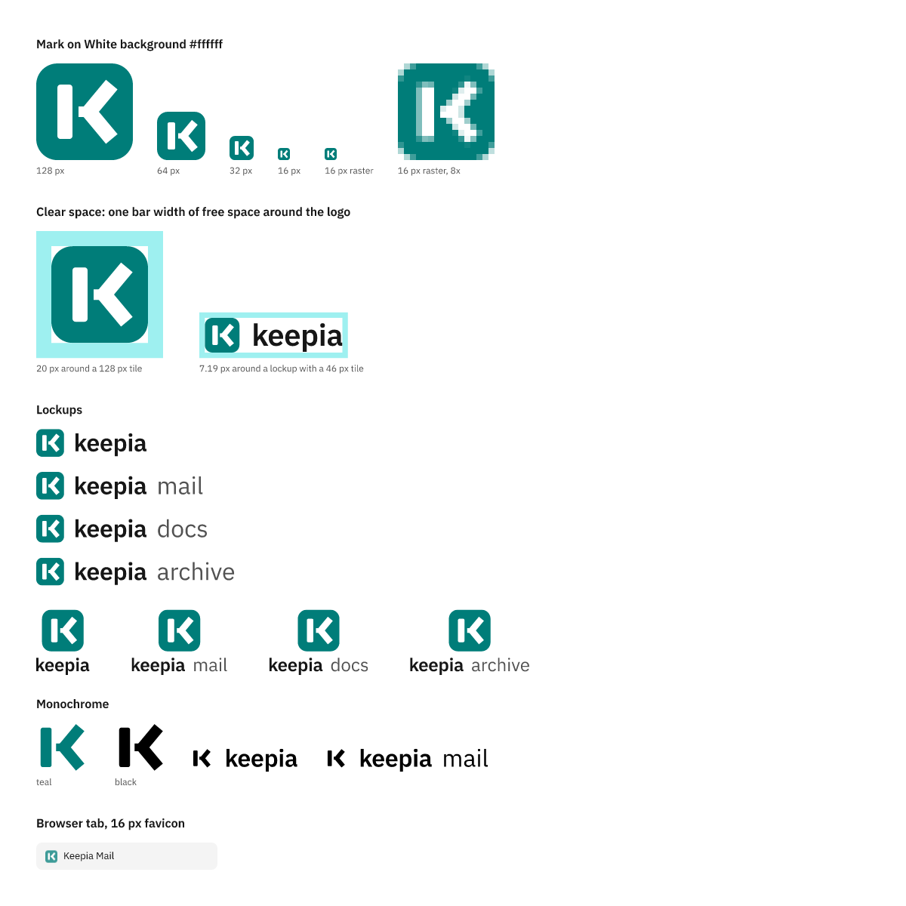
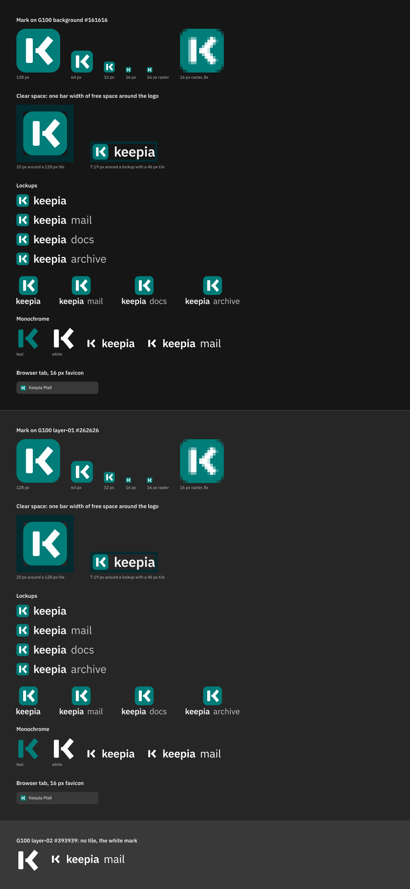
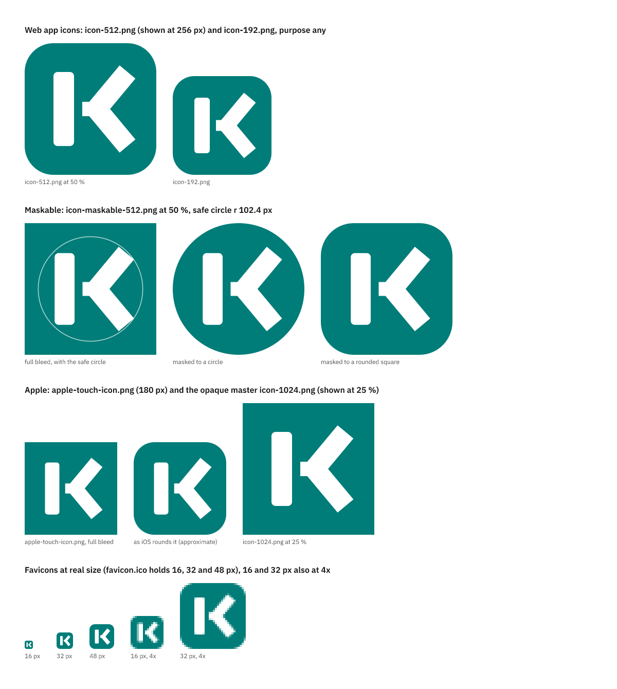

# Keepia design system

The brand of Keepia (Mail, Docs and Archive): **IBM Carbon v11 with Teal as the interactive colour**, the mark and the wordmark `keepia` in IBM Plex Sans.

This repository will hold the Carbon theme and tokens for White and G100, the logo, lockups, app icons and favicons, and a VitePress theme for the products' documentation, released as an npm-format tarball on a GitHub release. The work is planned in [keepia/mail#7](https://github.com/keepia/mail/issues/7) and tracked there. Part 1 set up the repository; part 2 added the Carbon theme, the tokens and the contrast checks (see Theme); part 3 adds the logo, lockups, app icons and favicons (see Logo). Nothing is released yet.

**Status: in development.**

## Building

Node 26, as declared in `.node-version`: the one place for the version. The workflows read it through the local action `.github/actions/setup` (`actions/setup-node` with `node-version-file`, then `npm ci --ignore-scripts`), `scripts/workflows.test.mjs` checks that nothing else names a Node version, and `devEngines` in `package.json` makes npm warn on an older Node when you work in this repository. `devEngines` (unlike `engines`) is ignored when the package is installed as a dependency, so the tarball puts no requirement on consumers.

```sh
npm ci --ignore-scripts   # no install scripts, as in CI
npm run build:all         # every generated file, in the order below
npm test                  # all tests (no network)
npm pack --dry-run --json --ignore-scripts | node scripts/check-pack.mjs   # the package contents
```

`npm run build:all` (`scripts/build_all.mjs`) is the one place that defines the order of the generation steps. It runs these commands, in this order, and stops at the first one that fails:

```sh
node scripts/build.mjs
node scripts/build_logo.mjs
node scripts/build_previews.mjs
node scripts/render_pngs.mjs
```

- `scripts/build.mjs` writes `theme/keepia-carbon.css`, `theme/_index.scss`, `theme/tokens.json`, `theme/contrast-report.json`, `fonts/` and `THIRD_PARTY_NOTICES.md` from `theme/brand.json` and the installed Carbon and IBM Plex packages.
- `scripts/build_logo.mjs` writes `theme/logo-geometry.json` and the brand SVGs in `brand/` from the logo section of `theme/brand.json`, the colours in `theme/tokens.json` and IBM Plex Sans (outlined with `opentype.js`).
- `scripts/build_previews.mjs` writes the sign-off sheets `brand/preview-*.svg` from the brand SVGs.
- `scripts/render_pngs.mjs` renders every PNG in `brand/` with resvg, writes `brand/favicon.ico` and `brand/manifest.json`.

The VitePress theme adds its step after these. `@resvg/resvg-js` and `opentype.js` are pinned exactly, because their output is committed and compared.

CI (step "Generated files are committed") runs `npm run build:all` and fails when it changes the tree, so generated files are committed together with the change that produces them.

The secret scan needs Go (the version in `tools/gitleaks/go.mod`) and is run with `make secrets-test secrets`; see [docs/development/index.md](docs/development/index.md).

## Theme

IBM Carbon v11, White and G100, with Teal as the interactive colour. Every Carbon Blue step becomes the same Teal step, including the Hover steps (`theme/brand.json`: `"primary": "teal"`). Status, syntax, AI, tag and `notification-background-info` tokens keep Carbon's colours, and so do visited links (Carbon's Purple stays distinct from Teal links). The G100 focus ring stays Carbon's white.

That changes 20 tokens in White and 19 in G100, 24 names in all; `theme/tokens.json` lists every colour token of both themes and, under `changed`, the ones that differ from Carbon. `theme/keepia-carbon.css` sets all 24 names in both theme blocks, each with its own theme's value, so a `:root` value of White never leaks into G100. Load it after Carbon's CSS and put `cds--white` or `cds--g100` on `<html>`:

```js
import '@carbon/styles/css/styles.css';
import '@keepia/design-system/theme/keepia-carbon.css';
```

Sass, through the `sass` export condition:

```scss
@use '@keepia/design-system/theme' as keepia;
@use '@carbon/styles/scss/theme' with ($theme: keepia.$g100);

.cds--g100 { @include keepia.overrides-dark; }   // component tokens (button) too
.cds--white { @include keepia.overrides-light; }
```

The package and its exports arrive with keepia/mail#7, part 5.

### Contrast

`scripts/contrast.test.mjs` checks both themes with WCAG 2.x ratios and fails `npm test` when a pair is below **4.5:1** for text or **3:1** for non-text UI (focus rings, borders, interactive icons, the logo tile). The pairs are in `scripts/contrast.mjs`; `theme/contrast-report.json` records every ratio. A pair of two unchanged Carbon values is exempt, but the exempt list is pinned in the test (today Carbon's White `support-warning` on `background` and `layer-01`, 1.68 and 1.53), so a new failing pair fails either way. The button focus ring passes when the better of `focus` and `focus-inset` reaches 3:1: in White, `focus` on the primary button is 1.00:1 and the inner ring gives 4.99:1.

The decided values: white on Teal 60 4.99:1, Teal 60 on White 4.99:1, Teal 40 on `#161616` 7.75:1, Teal 60 on `#161616` 3.63:1 (UI only).

## Logo

The mark is a latch: a white bar, a tongue that stops short of it and a chevron, on a Teal 60 tile (keepia/mail#7, maintainer decision 6807193549, "R3"). The wordmark is `keepia` in IBM Plex Sans SemiBold with −1 % tracking; product lockups add the product name in Plex Sans Regular in `text-secondary`. Mail, Docs and Archive share mark and colour.

All files are generated from one source (README, Building): the primitives on a 32-unit grid in `theme/brand.json`. `scripts/build_logo.mjs` turns the chevron, a stroke there, into one filled polygon and writes it with the outlined text to `theme/logo-geometry.json`; every file in `brand/` is drawn from that. The SVGs carry no text, fonts, strokes, styles, scripts, links, gradients, filters or images, so they render the same everywhere.







The sheets are generated (`brand/preview-*.svg`, rendered to PNG at 1 px per unit, so the favicon rasters show at their real size).

### Files

| File | Use |
| --- | --- |
| `brand/keepia-mark.svg`, `brand/favicon.svg` | The tile with the white mark (the app icon, the favicon) |
| `brand/keepia-mark-{teal,black,white}.svg` | The mark without tile, in one colour |
| `brand/keepia-wordmark-{light,dark,black,white}.svg` | The wordmark alone |
| `brand/keepia-lockup-{light,dark,black,white}.svg`, `brand/keepia-lockup-stacked-…` | Tile and wordmark, side by side or stacked |
| `brand/keepia-{mail,docs,archive}-lockup-…` | Product lockups, the same variants |
| `brand/favicon.ico` | 16, 32 and 48 px; `brand/favicon-{16,32,48}.png` are the same images |
| `brand/icon-192.png`, `brand/icon-512.png` | Web app manifest, `"purpose": "any"` |
| `brand/icon-maskable-512.png` (`icon-maskable.svg`) | Web app manifest, `"purpose": "maskable"`: full-bleed Teal, the mark inside the safe circle |
| `brand/apple-touch-icon.png` (180 px, `apple-touch-icon.svg`) | iOS home screen; full bleed, iOS rounds the corners |
| `brand/icon-1024.png` | The opaque master for iOS and macOS app icons; per-platform sets wait for a native app |
| `brand/manifest.json` | Every PNG with its size, its source SVG and both sha256 sums |

`light` is for the White theme (wordmark `text-primary` `#161616`), `dark` for G100 (`#f4f4f4`); `black` and `white` are single colour, with the mark without its tile. In HTML:

```html
<link rel="icon" href="/favicon.ico" sizes="32x32">
<link rel="icon" href="/favicon.svg" type="image/svg+xml">
<link rel="apple-touch-icon" href="/apple-touch-icon.png">
```

The brand files go into the package with keepia/mail#7, part 5 (maintainer decision M2); until then copy them from a commit of this repository.

### Usage rules

- **Clear space:** keep free space of one bar width (5/32 of the tile edge) around the logo, outside the tile or the lockup, on every side. The sheets show it as a frame.
- **Minimum size:** the tile 16 px. At 16 px the gap between bar and tongue is still one pixel column of the tile colour (tested).
- **Tile colour:** Teal 60 (`background-brand`) in both themes. In G100 place the tile only on `background` or `layer-01` (3.63:1 and 3.03:1). On `layer-02` and higher layers it reaches only 2.32:1: use the white mark without tile there.
- **Single colour:** the mark without tile in Teal 60, black or white; single-colour lockups in black or white.
- **Do not** recolour the tile per product, add gradients, shadows or outlines, rotate or stretch the mark, set the wordmark in live text in place of the files, or change the spacing in a lockup.

## Layout

| Path | Contents |
| --- | --- |
| `.node-version` | The Node major for development and CI (workflows, `devEngines`, tests); see Building |
| `.github/workflows/ci.yml` | The `check` job: generated files are committed, `npm test`, package contents |
| `.github/workflows/secrets.yml` | The `secret-scan` job: gitleaks on the commits a pull request or a push to `main` adds |
| `.github/actions/setup/` | The composite action with the Node and `npm ci` steps and the only pin of `actions/setup-node` |
| `.github/dependabot.yml` | Weekly version updates with a 14-day cooldown for npm, GitHub Actions (workflows and the composite action) and Go (`tools/gitleaks`) |
| `.gitleaks.toml`, `Makefile`, `scripts/secret-scan-*.sh` | The secret scan, taken from keepia/mail |
| `tools/gitleaks/go.mod` | Only the Go version the secret scan builds gitleaks with; this repository has no Go code |
| `theme/brand.json` | The brand input: the Carbon hue that replaces Blue, and the logo primitives and layout |
| `theme/logo-geometry.json` | The logo geometry derived from `theme/brand.json` (chevron outline, outlined text, lockup layout) |
| `brand/` | The generated logo files and the sign-off sheets (see Logo) |
| `theme/keepia-carbon.css`, `theme/_index.scss`, `theme/tokens.json`, `theme/contrast-report.json` | The generated theme (see Theme) |
| `fonts/` | IBM Plex Sans and Mono (woff2) with `OFL.txt`, copied from the npm packages |
| `THIRD_PARTY_NOTICES.md` | The packages whose values or files ship, with their licence texts |
| `scripts/build.mjs` | Generates the theme, fonts and notices |
| `scripts/build_logo.mjs`, `scripts/build_previews.mjs`, `scripts/render_pngs.mjs`, `scripts/png.mjs` | Generate the logo files, the sign-off sheets, the PNGs and `favicon.ico` |
| `scripts/logo.test.mjs` | The logo tests: geometry, pixel equivalence, 16 px gap, hygiene and colours, lockups, freshness, icons, contrast |
| `scripts/contrast.mjs` | The contrast pairs and the WCAG 2.x ratio |
| `scripts/build_all.mjs` | `npm run build:all`: the one entry point for all generation steps (see Building) |
| `scripts/check-pack.mjs` | Fixes the package contents, file by file, and forbids lifecycle scripts |
| `scripts/workflows.test.mjs` | The rules every workflow follows: pins, permissions, checkouts, the Node prelude, Dependabot |
| `scripts/*.test.mjs` | The tests, run by `npm test` (no network) |
| `scripts/theme.test.mjs`, `scripts/contrast.test.mjs` | The token mapping, the generated theme files and the contrast checks |
| `scripts/fixtures/` | Captured data the tests read (an `npm pack` sample) |
| `docs/development/index.md` | The checks on every pull request |

## Security

Report vulnerabilities privately; see [SECURITY.md](SECURITY.md).

## License

- Code in this repository: [MIT](LICENSE).
- Brand assets (the name "Keepia", the wordmark, the mark, lockups and app icons): all rights reserved, see the exceptions in [LICENSE](LICENSE).
